# az-legal-rag — Azerbaijani Labour Code AI Legal Assistant

An intelligent, multi-turn RAG-based legal assistant grounded strictly in the **Azerbaijani Labour Code (*Azərbaycan Respublikasının Əmək Məcəlləsi*)**.

Unlike single-shot legal search engines (such as e-qanun.ai), **az-legal-rag** is built as a multi-turn "case builder": it converses with users, asks clarifying questions to extract key facts regarding their labour dispute, tracks state across dialogue turns, and generates grounded legal complaint drafts (*ərizə*) citing exact statutory articles.

---

## 🚀 Key Features & Architecture

- **PDF Extraction & Layout Parsing**: Built using `PyMuPDF` with full preservation of Azerbaijani Latin diacritics (`ə, ğ, ı, ö, ş, ü, ç`). Extracts 325 legal articles (Maddə 1 to Maddə 317 + amendments) while excluding endnote amendment histories.
- **Context-Preserving Legal Chunking**: Chunks articles along clause boundaries while retaining article numbers, headings, and chapter metadata in every chunk.
- **Hybrid Retrieval (Dense + Lexical BM25)**:
  - **Dense Embeddings**: `BAAI/bge-m3` (1024-dimensional multilingual embeddings) stored in local ChromaDB.
  - **Lexical Matching**: `BM25Okapi` with customized Azerbaijani legal tokenization and IDF flooring.
  - **Fusion**: Reciprocal Rank Fusion (RRF, $k=60$) producing calibrated confidence scores in $[0.0, 1.0]$.
- **Anti-Hallucination Guardrails**: Strict article grounding and a standardized fallback message in Azerbaijani if no article meets the relevance threshold.
- **Trainable ML Component**: Dispute-category classification using Logistic Regression on top of `bge-m3` embeddings.

---

## 📋 Team & Project Kanban Board

```mermaid
graph LR
    subgraph BACKLOG["📋 Backlog (Phases 6.5 - 11)"]
        direction TB
        B1["Phase 6.5: Train ML Classifier (bge-m3)"]
        B2["Phase 7: CaseState & Session Store"]
        B3["Phase 8: Multi-turn Dialogue"]
        B4["Phase 9: Complaint Generation (Ərizə)"]
        B5["Phase 10: Streamlit UI"]
        B6["Phase 11: Final Audit"]
    end

    subgraph IN_PROGRESS["⚙️ In Progress (Phases 4 - 6)"]
        direction TB
        P1["Phase 4: Guardrails & Citation Filter"]
        P2["Phase 5: One-shot QA Generation"]
        P3["Phase 6: Dispute Slot Schema"]
    end

    subgraph DONE["✅ Done (Phases 0 - 3)"]
        direction TB
        D0["Phase 0: Architecture & Specs<br>👤 Ibrahim Ramazanzada"]
        D1["Phase 1: PDF Ingestion (325 Articles)<br>👤 Ibrahim Ramazanzada"]
        D2["Phase 2: bge-m3 & BM25 Indexing<br>👤 Xeyransa Gorchuyeva"]
        D3["Phase 3: Hybrid Retrieval & Demo<br>👤 Alinur Zamanli"]
    end

    DONE --> IN_PROGRESS --> BACKLOG
```



| Phase | Module / Responsibility | Assignee | Status | Deliverable |
| :--- | :--- | :--- | :---: | :--- |
| **Phase 0** | Project Specifications, Standards & Env Config | **Ibrahim Ramazanzada** | `DONE` ✅ | `src/config.py`, `requirements.txt` |
| **Phase 1** | PDF Ingestion, Diacritic Cleaner & 325 Articles Parser | **Ibrahim Ramazanzada** | `DONE` ✅ | `src/ingestion/`, `data/processed/articles.json` |
| **Phase 2** | Contextual Chunking, `bge-m3` Embeddings & BM25 Index | **Xeyransa Gorchuyeva** | `DONE` ✅ | `src/indexing/`, `data/chroma_db/`, `bm25_index.pkl` |
| **Phase 3** | Hybrid RRF Retrieval Engine ($k=60$) & Benchmark CLI | **Alinur Zamanli** | `DONE` ✅ | `src/retrieval/`, `demo.py` |
| **Phase 4** | Retrieval Thresholds, Citation Validation & Guardrails | *Team* | `IN PROGRESS` ⚙️ | `src/guardrails/` |
| **Phase 5** | Grounded One-Shot Legal QA Generation | *Team* | `TODO` 📋 | `src/generation/qa_prompts.py` |
| **Phase 6** | Dispute Categories & Slot Schema Definition | *Team* | `TODO` 📋 | `src/dialogue/slot_schema.py` |
| **Phase 6.5**| **Trained ML Dispute Classifier** (Logistic Regression on `bge-m3`) | *Team* | `TODO` 📋 | `notebooks/`, `category_classifier.py` |
| **Phase 7-8**| CaseState, Session Persistence & Multi-Turn Dialogue | *Team* | `PLANNED` 📅 | `src/dialogue/` |
| **Phase 9** | Structured Legal Complaint Generation (*Ərizə Layihəsi*) | *Team* | `PLANNED` 📅 | `src/generation/case_prompts.py` |
| **Phase 10**| Streamlit Web Application & Interactive UI | *Team* | `PLANNED` 📅 | `app/` |
| **Phase 11**| System Audit, pycodestyle Compliance & Evaluation | *Team* | `PLANNED` 📅 | Walkthrough & Benchmarks |

---

## 📂 Project Structure

```text
az-legal-rag/
├── data/
│   ├── raw/                   # Source Labour Code PDF (emek_mecelle.pdf)
│   ├── processed/             # Cleaned articles.json (325 articles) & bm25_index.pkl
│   └── training_data/         # Labeled examples for category classifier
├── src/
│   ├── config.py              # Centralized settings, thresholds & disclaimers
│   ├── ingestion/             # PDF text extraction, diacritic cleaning & parsing
│   ├── indexing/              # Chunking, bge-m3 embeddings & ChromaDB/BM25 indexing
│   ├── retrieval/             # Hybrid RRF retriever (dense + lexical BM25)
│   ├── dialogue/              # CaseState, session store & category classifier (Phase 6-8)
│   ├── generation/            # One-shot QA & draft complaint prompts (Phase 5, 9)
│   ├── guardrails/            # Grounding & citation verification (Phase 4)
│   └── utils/                 # Standardized logging
├── app/                       # Streamlit UI (Phase 10)
├── docs/                      # Phase completion walkthroughs & reports
├── tests/                     # Test suites for ingestion, indexing & retrieval
├── demo.py                    # Interactive CLI demo & automated benchmark
├── requirements.txt
└── README.md
```

---

## 🛠️ Quickstart

### 1. Clone & Install Dependencies
```bash
git clone https://github.com/<your-username>/az-legal-rag.git
cd az-legal-rag

python -m venv venv
venv\Scripts\activate      # On Windows
# source venv/bin/activate  # On Linux/macOS

pip install -r requirements.txt
```

### 2. Run the Interactive Mentor Demo / Benchmark
```bash
# Automated benchmark across 5 core labour topics (dismissal, wages, leave, probation, etc.)
python demo.py

# Or interactive mode to ask any custom question live
python demo.py --interactive
```

### 3. Rebuild Search Indices (Optional)
```bash
python -m src.indexing.build_index
```

### 4. Run Test Suites
```bash
python -m tests.test_ingestion
python -m tests.test_indexing
python -m tests.test_retrieval
```

---

## ⚖️ Legal Disclaimer

> **XƏBƏRDARLIQ**: Bu sistem yalnız məlumatlandırma xarakteri daşıyır və peşəkar hüquqi məsləhət hesab edilmir.
> *(DISCLAIMER: This system is for informational purposes only and does not constitute professional legal counsel.)*